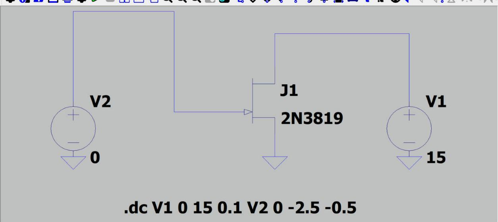
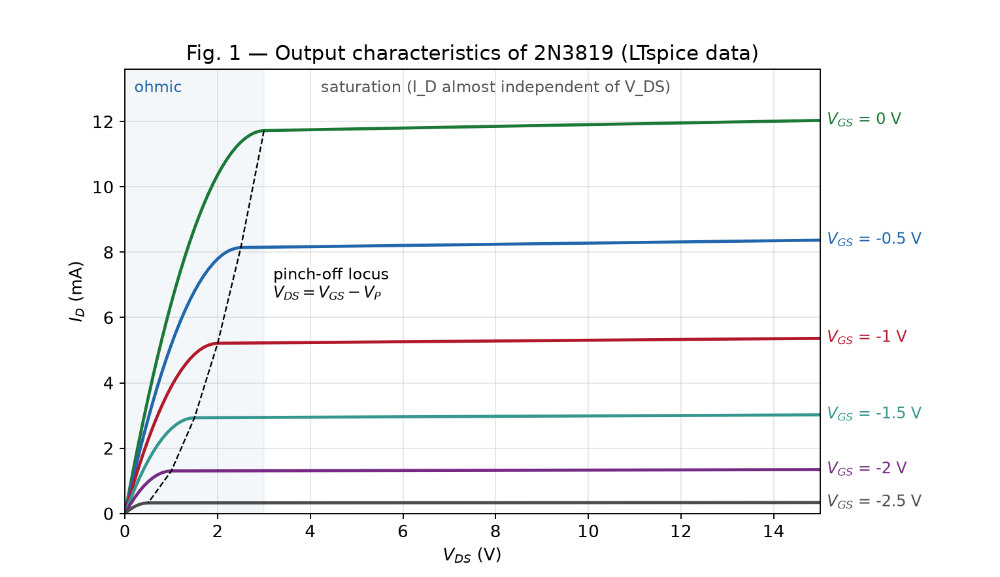
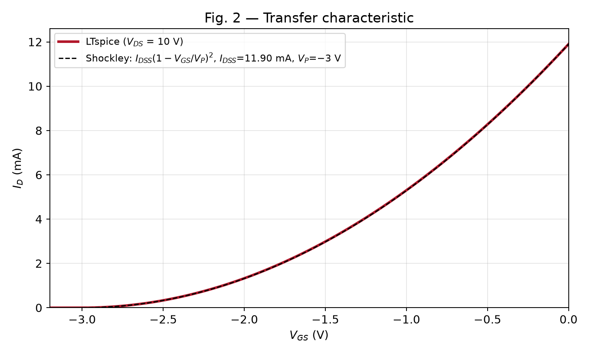
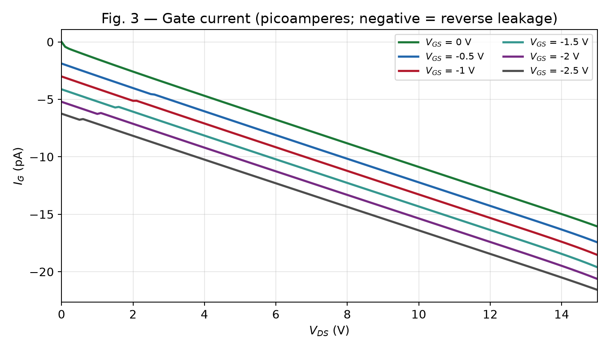

# Project Part B — Q6(b): Output Characteristics of a JFET

> **Problem statement.** Simulate, observe and analyse the output characteristics of a JFET, infer its behaviour, and explain: **(i)** JFET is a voltage-controlled current source, **(ii)** JFET has high input impedance.

**Full write-up:** [`Project_Part_B_JFET_Report.pdf`](Project_Part_B_JFET_Report.pdf) · **Slides:** [`JFET_Presentation.pdf`](JFET_Presentation.pdf)

## 1. Setup

| Item | Value |
|---|---|
| Device | **2N3819** n-channel JFET (LTspice standard model library) |
| Tool | **LTspice** (Analog Devices) — DC sweep analysis |
| Circuit | Common-source: source grounded, **V1** = drain supply ($V_{DS}$), **V2** = gate supply ($V_{GS}$) |
| Run 1 — output characteristics | `.dc V1 0 15 0.1 V2 0 -2.5 -0.5` → $V_{DS}$ 0→15 V in 0.1 V steps, for $V_{GS}$ = 0, −0.5, −1, −1.5, −2, −2.5 V (6 × 151 = 906 points) |
| Run 2 — transfer characteristic | $V_{DS}$ fixed at 10 V, `.dc V2 -3.2 0 0.01` |

## 2. Output characteristics ($I_D$ vs $V_{DS}$)

- **Ohmic region** ($V_{DS}$ small): $I_D$ rises almost linearly with $V_{DS}$ — the channel behaves like a resistor whose value is set by $V_{GS}$.
- **Pinch-off:** each curve bends at $V_{DS} = V_{GS} - V_P$ (dashed line), with $V_P \approx -3$ V.
- **Saturation region:** the curves are almost flat — $I_D$ is fixed by $V_{GS}$, not by $V_{DS}$.
- **Cut-off:** at $V_{GS} \le V_P \approx -3$ V, $I_D \approx 0$ (Run 2: $I_D$ = 0.013 mA at −2.9 V, 0 at −3.0 V).

### Values read from the simulation data

| $V_{GS}$ (V) | $I_D$ at $V_{DS}$ = 5 V (mA) | $I_D$ at $V_{DS}$ = 15 V (mA) | Change |
|---|---|---|---|
| 0 | 11.77 | 12.03 | 2.2 % |
| -0.5 | 8.19 | 8.37 | 2.2 % |
| -1 | 5.25 | 5.36 | 2.2 % |
| -1.5 | 2.96 | 3.02 | 2.2 % |
| -2 | 1.32 | 1.34 | 2.2 % |
| -2.5 | 0.33 | 0.34 | 2.2 % |

Tripling $V_{DS}$ (5 → 15 V) changes $I_D$ by only **≈ 2.2 %**, while moving $V_{GS}$ from 0 to −2.5 V cuts $I_D$ about **36×**.

## 3. Transfer characteristic ($I_D$ vs $V_{GS}$)

The curve is a parabola that follows **Shockley's equation** $I_D = I_{DSS}(1 - V_{GS}/V_P)^2$ with $I_{DSS}$ = 11.90 mA (at $V_{DS}$ = 10 V) and $V_P$ = −3 V.
Check at $V_{GS}$ = −1.5 V: 11.90 × (0.5)² = **2.98 mA**; simulation gives **2.99 mA**.
Transconductance near $V_{GS}$ = 0: $g_m = \Delta I_D / \Delta V_{GS}$ ≈ **7.9 mS** (theory $2I_{DSS}/|V_P|$ ≈ 7.9 mS).

## 4. Inference (i) — JFET is a voltage-controlled current source

- **Current source:** in saturation, $I_D$ stays almost constant (≈ 2.2 % change) while $V_{DS}$ triples — just as an ideal current source delivers a fixed current whatever the voltage across it.
- **Voltage-controlled:** *which* constant current flows is set only by $V_{GS}$ (0 V → 11.8 mA, −1 V → 5.2 mA, −2 V → 1.3 mA), and the gate draws practically no current (Section 5), so the control is by voltage, not current.
- Small-signal form: $i_d = g_m\,v_{gs}$ — the defining relation of a VCCS. (Contrast: a BJT is current-controlled, $I_C = \beta I_B$.)

## 5. Inference (ii) — JFET has high input impedance

- The gate–channel p–n junction is **reverse-biased** ($V_{GS} \le 0$), so only a tiny leakage current flows into the gate.
- Largest simulated gate current: $|I_G|$ ≈ **21.6 pA** (at $V_{GS}$ = −2.5 V, $V_{DS}$ = 15 V). It grows with $V_{DS}$ because the gate–drain junction is reverse-biased by $V_{DS} - V_{GS}$.
- Input resistance: $R_{in} \approx |V_{GS}| / |I_G|$ = 2.5 V / 21.6 pA ≈ **116 GΩ (~10¹¹ Ω)**.
- Datasheet cross-check (2N3819): $I_{GSS}$ ≤ 2 nA at $V_{GS}$ = −15 V → $R_{in}$ ≥ 7.5 GΩ.
- $I_D$ is in **milliamperes**, $I_G$ in **picoamperes** — about 10⁹ times smaller — so the JFET does not load the signal source.

## 6. Conclusions

1. The simulated output characteristics show the ohmic, saturation and cut-off regions, with $I_{DSS}$ ≈ 11.8–11.9 mA and $V_P$ ≈ −3 V.
2. In saturation $I_D$ is nearly independent of $V_{DS}$ and set only by $V_{GS}$ → **voltage-controlled current source**.
3. The gate current is in picoamperes → **input resistance ~10¹¹ Ω**.
4. The transfer curve agrees with Shockley's equation.

Applications: JFET-input op-amps (TL071/TL081), electret microphone pre-amps, high-impedance test probes / pH meters, constant-current sources.

## Files

| Path | Description |
|---|---|
| `Project_Part_B_JFET_Report.pdf` | Full write-up of this project |
| `JFET_Presentation.pdf` | 10-slide presentation |
| `ltspice/*.asc` | LTspice schematics (open in LTspice and press Run to reproduce) |
| `ltspice/*.raw`, `ltspice/*.log` | Simulation output and logs |
| `ltspice/Output_Characteristics_Id_data.txt` | Exported $I_D$ data |
| `figures/` | LTspice screenshots and plots generated from the simulation data |
