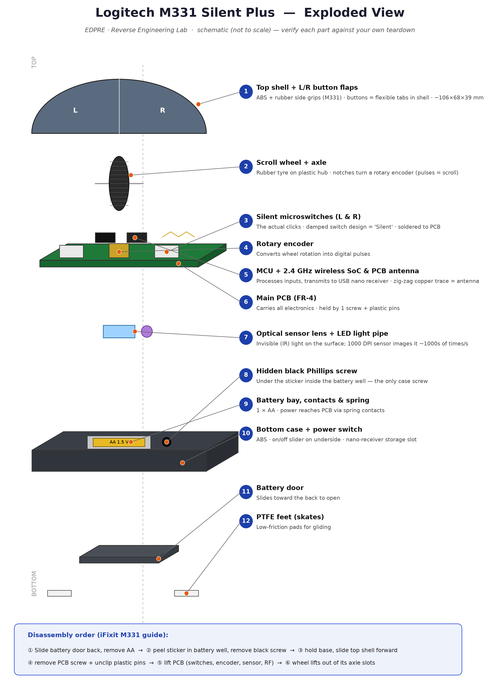

# RE Project — Logitech M331 Silent Plus Wireless Mouse

Reverse-engineering activity report prepared during the physical sessions.

| File | Description |
|---|---|
| [`M331_Reverse_Engineering_Report.pdf`](M331_Reverse_Engineering_Report.pdf) | **Main submission** — the activity report (12 pages) |
| [`M331_Reverse_Engineering_Report.docx`](M331_Reverse_Engineering_Report.docx) | Editable source of the same report |
| [`M331_Presentation.pdf`](M331_Presentation.pdf) | Presentation slides (11 slides) |
| [`M331_Exploded_View.png`](M331_Exploded_View.png) | Exploded-view figure used in the report |

## Report structure

- **Part I — Studying the product:** external features, subsystems, modes of operation, purpose, user needs.
- **Part II — Product origin to latest inventions:** evolution of the mouse (mechanical wheel → ball → optical → wireless/laser → current), core technologies in the M331, engineering importance.
- **Part III — Internal components & working flow:** photographs of internals, functional block diagram, five subsystems (power, optical tracking, input, processing & 2.4 GHz wireless, mechanical), step-by-step working flow, bill of materials, component ratings, component function table.
- **Simulation (Tinkercad Circuits):** an Arduino model of the mouse — potentiometers for Δx / Δy / scroll, push-buttons for left / right / middle click, a slide switch for power — printing HID-style reports on the Serial Monitor. Program code included.

